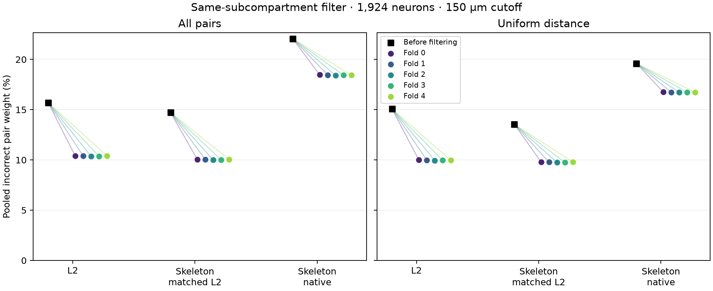

# Historical pair error after subcompartment filtering

Completed 2026-11-08. Retaining only pairs whose endpoints have the same
predicted subcompartment reduces pooled pair error in all three geometries.
This comparison uses the same **1,924 neurons**, a **150 µm** path-distance cutoff,
and five separately evaluated six-class classifiers. Ranges below span the five
folds; they are not confidence intervals.

| Geometry | Sampling | Before | After | Pair weight retained |
|---|---|---:|---:|---:|
| L2 | All pairs | 15.69% | 10.36–10.41% | 81.43–81.63% |
| L2 | Uniform distance | 15.08% | 9.95–9.99% | 81.08–81.26% |
| Skeleton, matched L2 endpoints | All pairs | 14.73% | 9.99–10.04% | 82.14–82.35% |
| Skeleton, matched L2 endpoints | Uniform distance | 13.56% | 9.75–9.79% | 81.85–82.06% |
| Skeleton, native endpoints | All pairs | 22.07% | 18.42–18.47% | 86.26–86.35% |
| Skeleton, native endpoints | Uniform distance | 19.60% | 16.72–16.75% | 89.32–89.39% |

The original distance-bin sampling weights are fixed before filtering. The
filtered error is incorrect retained weight divided by total retained weight.
These are pooled per-neuron pair exposures; an incorrect pair can contribute to
two reference neurons. This preserves the original audit's fractional
supervoxel-membership error proxy. Outside material is not necessarily assigned
to another independently verified neuron.

Another **165 neurons** lack complete historical skeleton coverage and are
excluded from every geometry. Native skeleton pairs use the original occupied
vertices and supervoxel-count-weighted membership. Classifications filter pair
endpoints only: graph paths remain intact, and distinct L2 endpoints collapsed
onto one vertex retain their individual labels.

Improvement is not universal. For all-pair sampling, 1,614–1,621 neurons improve
with L2 paths and 1,548–1,560 improve with native skeleton endpoints. The full
per-neuron table includes the baseline rate, filtered rate, and retention for
each fold, geometry, and policy. All neurons retain some pair weight.

* [Compact comparison](comparison_compact.csv)
* [All five folds and six sampling policies](cohort_comparison.csv)
* [Per-neuron results, compressed CSV](cell_scores.csv.gz)
* [Pooled class and cohort results](pooled_scores.csv)
* [Casey family results](casey_family_comparison.csv)
* [Unresolved Casey labels, kept separate](unresolved_casey_comparison.csv)
* [Per-neuron comparison plot](neuron_comparison.png)
* [Excluded neurons](excluded_cells.json)
* [Analysis plan](plan.json), [final validation](final_validation.json)
* [Method and execution details](../../deployment/PAIR_FILTER.md)

Every neuron reproduced the original correct/incorrect histograms for all three
geometries before its result was accepted. A final independent check matched
all original per-neuron baselines and recomputed the pooled totals from the
**173,160** unique neuron/geometry/policy/fold result rows. The implementation
also passed exhaustive synthetic pair-enumeration tests.

The table can be loaded with `pandas.read_csv('cell_scores.csv.gz',
dtype={'root_1718': str})`. It includes all-pair and uniform-distance policies,
plus exponential-distance scales of 15, 30, 50, and 100 µm.
